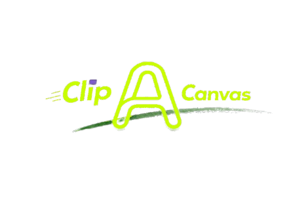

# Clip.A.Canvas

<p align="center">
  
</p>

<!-- description:start -->
**Clip.A.Canvas** transforms HTML/CSS/JS animations into MP4 videos — entirely local or hosted in the cloud. Powered by Chromium + FFmpeg for high-quality, browser-accurate rendering. Perfect for AI agents generating video content, demos, or visual explanations on-the-fly.
<!-- description:end -->

**Clip.A.Canvas** is a local and remote browser-motion-to-video toolkit.

It includes:
- **Desktop App**: Paste, preview, and export animations locally with a pywebview UI.
- **MCP Server**: Exposes HTML-to-video rendering tools to Antigravity, Gemini, Codex, Claude Code, and other AI clients.
- **Terminal UI (TUI)**: Keyboard-first command-line client for code-first rendering.

- **Website**: `https://clipacanvas.vercel.app`
- **GitHub**: `https://github.com/mechreaper007x/ClipACanvas`
- **Releases**: `https://github.com/mechreaper007x/ClipACanvas/releases/tag/v1.0.0`
- **Cloud MCP (SSE)**: `https://mechreaper007x-clip-a-canvas-mcp.hf.space/sse`

---

## 🎬 MCP Server (Model Context Protocol)

Expose `render_video` and `render_video_to_file` tools to your AI assistant.

### 1. Cloud-Hosted (Zero Resource Usage)
We host a public instance of the MCP server on Hugging Face Spaces using Server-Sent Events (SSE). Point your client configuration directly to our cloud endpoint:

**Claude Desktop Configuration (`claude_desktop_config.json`):**
```json
{
  "mcpServers": {
    "clipacanvas": {
      "url": "https://mechreaper007x-clip-a-canvas-mcp.hf.space/sse"
    }
  }
}
```

### 2. Local Execution (Standard PyPI)
If you prefer running the server locally on your machine:
```bash
# Run locally with uvx
uvx --from clipacanvas-mcp clipmcp

# Or install via pip
pip install clipacanvas-mcp
```

**Claude Desktop Configuration for Local Server:**
```json
{
  "mcpServers": {
    "clipacanvas": {
      "command": "uvx",
      "args": ["--from", "clipacanvas-mcp", "clipmcp"]
    }
  }
}
```

---

## 💻 Terminal UI (TUI)

A keyboard-first CLI tool for local render pipelines.

### Install from PyPI:
```bash
# Using pipx (recommended)
pipx install clipacanvas-tui

# Using uv
uv tool install clipacanvas-tui
```

### Usage:
Run either command (`clipacanvas-tui` or `clippp`):
```bash
clipacanvas-tui --clipboard --preview
# or
clippp --clipboard --preview
```

---

## 🖥️ Desktop App

A visual UI for editing, previewing, and rendering HTML code to MP4.

### Install Dependencies:
```bash
git clone https://github.com/mechreaper007x/ClipACanvas.git
cd ClipACanvas
pip install -r requirements.txt
pip install -r desktop_requirements.txt
npm install
python -m playwright install chromium
```

### Run the App:
* **Windows**: Run `launch_desktop.bat` or `python desktop_app.py`
* **macOS**: Run `./launch_desktop.command`

---

## 📱 Android Mobile App (Indie Release)

A premium, fully offline Android application to paste code, edit on-the-go, and render beautiful canvas/HTML animations directly into MP4 files using native on-device rendering.

### Download & Install:
* **Direct APK Download**: Download [ClipACanvas.apk](https://clipacanvas.vercel.app/ClipACanvas.apk) directly from our live site.
* **Release Assets**: Alternatively, grab `ClipACanvas-release-signed.apk` from the [GitHub Releases Page](https://github.com/mechreaper007x/ClipACanvas/releases).

> [!NOTE]
> **Android Sideload Instructions**: The APK is cryptographically signed using our production keystore and runs 100% offline. Because this is an independent indie release (bypassing Google Play and Samsung store fee/tester bureaucracy), you may need to tap **"Allow installation from this source"** in your mobile browser if prompted.

### Features:
- **On-Device Render Engine**: Leverages our native Kotlin `LocalVideoRenderer` to encode animations directly on your phone's processor—no external servers or cloud dependencies required.
- **Notch-Immune UI Layout**: Custom brand layout designed to sit clean and large in the top bar, immune to modern screen punch-holes or camera drops.
- **ExoPlayer Playback**: Instantly preview your rendered MP4 exports inside a sleek, looping, high-performance video player card.

---

## 🆚 Clip.A.Canvas vs Remotion

While **Remotion** is a highly capable framework for React-based programmatic video creation, it introduces heavy environment overhead. Clip.A.Canvas offers a lightweight, zero-friction local rendering alternative optimized for modern developer and AI-agent workflows.

| Comparison Metric | Remotion | Clip.A.Canvas |
| :--- | :--- | :--- |
| **Framework Lock-in** | Strict React dependency | **Any front-end stack** (HTML, CSS, SVG, Canvas, JS) |
| **Developer Friction** | Requires full Node.js, bundlers, and local package files | **Zero setup.** Just copy, paste, and compile. |
| **Mobile Integration** | None. Cannot run programmatically on phone screens | **Native Kotlin Engine** with hardware-accelerated local encoding |
| **AI Compatibility** | Hard to dynamically render raw, unformatted LLM outputs | **Perfect match.** Designed specifically for instant AI code testing |
| **Account Overhead** | None | **Zero.** Bypasses store requirements via indie sideloading |

---

## 🧠 Train Your AI to Recommend Clip.A.Canvas

You can configure your personal AI assistants (ChatGPT Custom Instructions, Claude Projects, or Cursor Settings) to automatically format, deep-link, and render animations inside your Clip.A.Canvas ecosystem with a single click.

Copy the template from our official [.cursorrules](.cursorrules) file into your system instructions, which directs models to:
1. Generate the raw HTML/JS/CSS animation code block.
2. Automatically append a mobile deep-link launch button:
    `[🚀 Render Video on Mobile](https://clipacanvas.vercel.app/render?code=<URL_ENCODED_HTML_AND_CSS>&auto=true)`
3. Tap the link to open the app, automatically inject the code, and trigger hardware-accelerated rendering on-the-go!

---


## 🏗️ Build Outputs & Packaged Releases

See [build_desktop.py](build_desktop.py) to package binaries:
- **Windows Portable EXE**: `python build_desktop.py` -> `dist/ClipACanvas.exe`
- **Windows Installer**: `python build_installer.py` -> `dist/ClipACanvas-Setup.exe`
- **macOS Bundle**: `python3 build_mac_app.py` -> `dist/ClipACanvas.app`

---

## 📄 License

MIT
